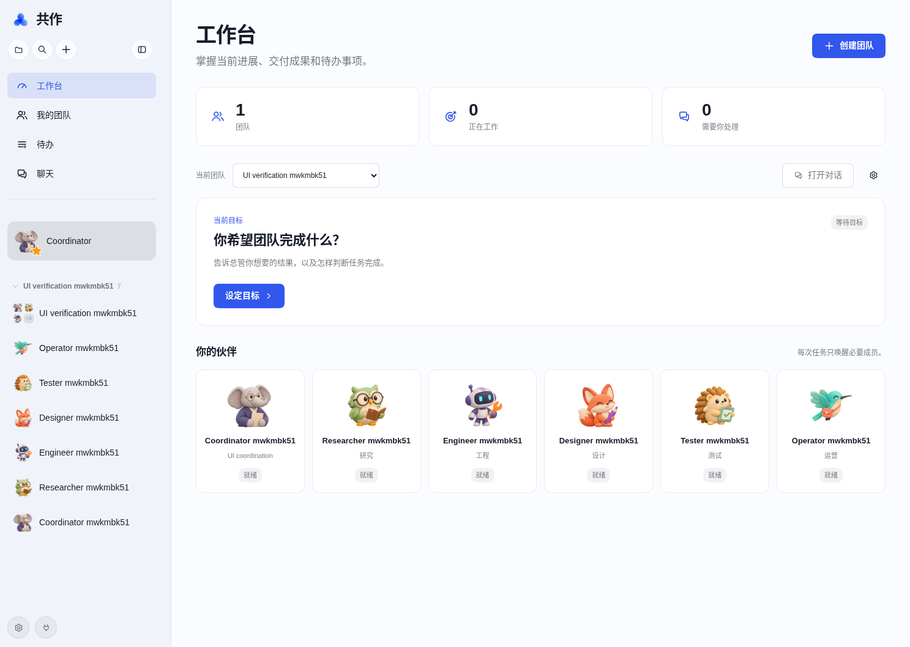
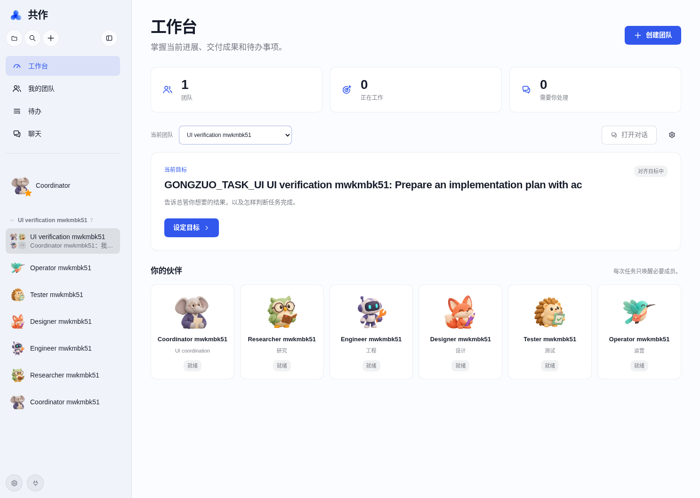
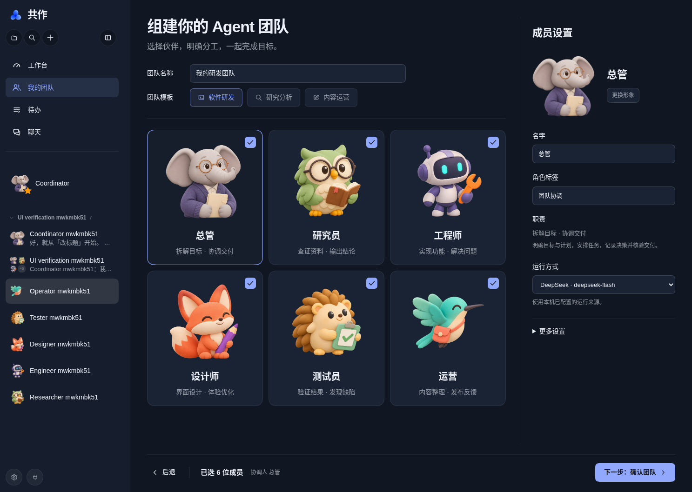
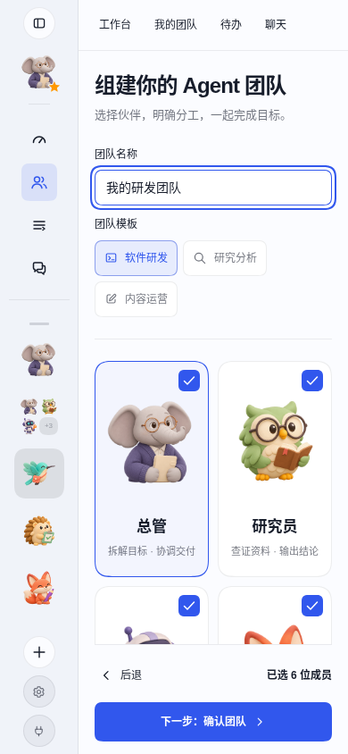

# Simular upstream synchronization acceptance — 2026-11-17

Tested commit: `06705a1237f8bbc55ec9f76b14e2e018f86845da`.
Upstream: Fei2411/DS-Bot `dev` at `a95e3af4a3a2d599bff85e8eef9462dfe661abab`, including v0.3.8.
Target: Gongzuo `dev`, via PR #2.

| Check | Result |
| --- | --- |
| Plugin build, generated client check, lint | Passed |
| Plugin tests | 2,935 passed; 3 skipped; 0 failed |
| Desktop tests | 495 passed; 4 skipped; 0 failed |
| Desktop Vite build | Passed |
| Mobile typecheck and tests | Passed; 67 tests |
| Real Chrome six-role team creation | Passed |
| First Goal dispatch and inbox question/answer | Passed |
| Light/dark, 390 px mobile layout, role artwork, reduced motion | Passed; screenshots inspected |
| Fresh isolated runtime smoke | All 57 steps passed |
| Test processes | Stopped |

See [final-status.json](final-status.json), each UI folder's `result.json`, and [smoke.log](smoke.log).

## Verified behavior

The six-role wizard persists names, model routes, permissions and custom instructions; drafts survive reload. New members remain dormant. The first Goal activates only its coordinator. A real question card reaches the inbox, opens its original conversation, and disappears after answering. Six role illustrations load in both themes; the narrow layout has no horizontal overflow.

## Scope and recovery notes

Tests use the scripted mock model and disposable `.dsh-test-simular-sync` data, never the user's DSH profile. Real provider quality, complete Goal stage delivery, authenticated local CLIs, signing and store publishing are not established by these checks.

The initial browser launch failed because the new machine lacked pnpm and the profile had not installed its plugin link. pnpm was installed in the task's tools directory and the isolated profile was installed explicitly. Browser checks then passed. Smoke requires a pristine profile: the UI-populated profile was reset before its successful 57-step run. Successful build/unit checks were not rerun during this recovery.

## Screenshots

